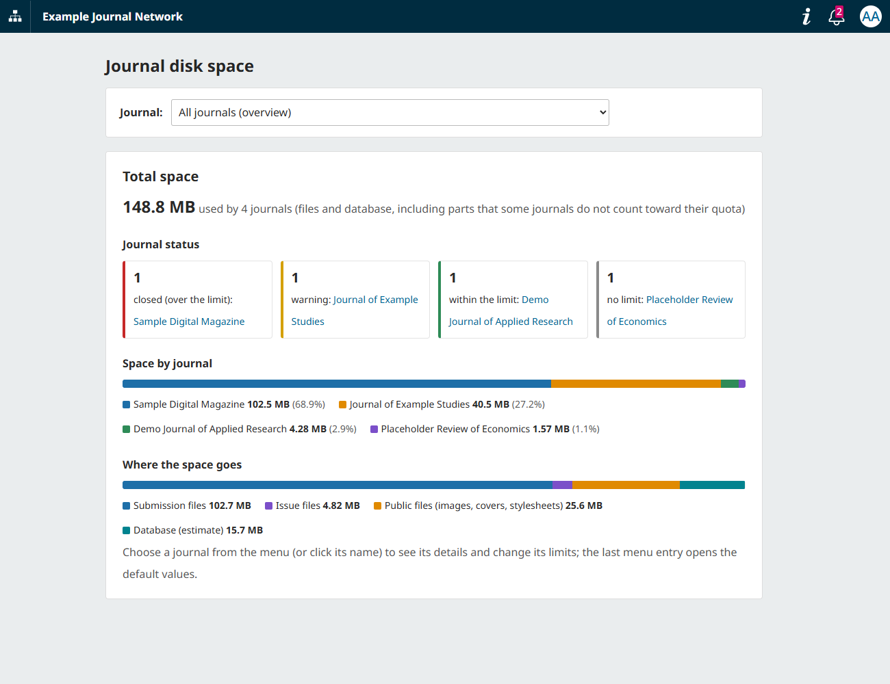
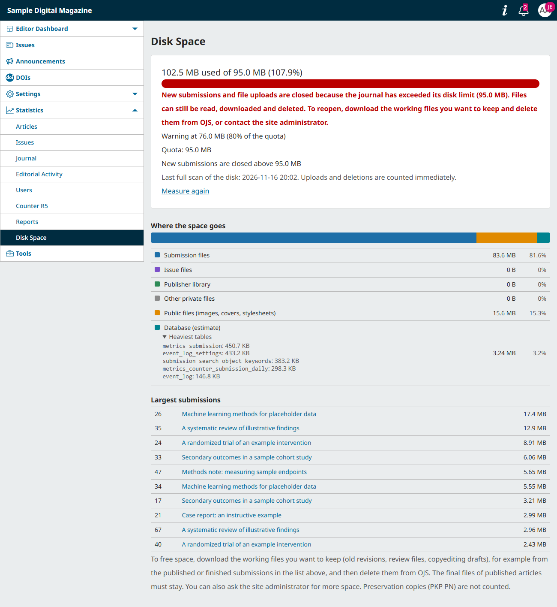

<!--
README.md
Copyright (C) 2026 Stefano Natangelo
SPDX-License-Identifier: AGPL-3.0-only
-->

# Journal Quota for OJS

[](#compatibility)
[](https://github.com/SNatangelo/ojs-journal-quota/releases/tag/v1.0.0.1)
[](LICENSE)

Journal Quota is an open-source storage quota plugin for [Open Journal Systems (OJS)](https://pkp.sfu.ca/software/ojs/). It tracks disk usage **per journal** and enforces configurable storage limits across a shared, multi-journal OJS installation.

It is intended for university libraries, scholarly publishing services, and other OJS hosting providers managing multiple journals on one installation. Site administrators can set default and journal-specific quotas, monitor usage, and configure warnings or upload restrictions. Journal managers can view their own usage and receive alerts before reaching a limit. Existing files remain accessible when a quota is exceeded.

**Get started:** [Download v1.0.0.1](https://github.com/SNatangelo/ojs-journal-quota/releases/tag/v1.0.0.1) · [Illustrated user guide](https://github.com/SNatangelo/ojs-journal-quota/blob/main/docs/user-guide.md) · [Report an issue](https://github.com/SNatangelo/ojs-journal-quota/issues)

## Features

- Site-wide default quotas and individual journal overrides.
- A site overview, per-journal usage breakdowns and lists of the largest submissions.
- Accounting for submission files, issue files, publisher libraries and other private files; optional inclusion of public files and estimated database usage.
- Configurable warning thresholds, storage tolerance, in-app notifications and email reminders.
- Immediate accounting for supported file changes, periodic full reconciliation and database-backed reservations for concurrent uploads.
- English and Italian interfaces.

## Screenshots and user guide

The screenshots below use fictional journals, users and submissions from a local OJS 3.5 test installation. They do not show hosted journals or production data.

**Site administrator — all journals at a glance**



**Journal manager — disk space and an enforced limit**



See the [illustrated user guide](https://github.com/SNatangelo/ojs-journal-quota/blob/main/docs/user-guide.md) for per-journal settings, default limits, warnings, notifications, email templates and the submission experience.

## Compatibility

Version **1.0.0** was developed for **OJS 3.5.0-6**. It is installed and functioning on **JSENetwork with MySQL**; development testing used a separate local OJS 3.5.0-6 Docker installation with MariaDB/InnoDB.

Version **1.0.0.1** is a maintenance release prepared for the PKP Plugin Gallery's four-part versioning requirement. It incorporates the English server-log messages and documentation added since v1.0.0. The live deployment and development evidence above refer to v1.0.0; they do not establish that v1.0.0.1 has passed a fresh installation or upgrade test.

Other OJS versions and database engines beyond MySQL/MariaDB have not yet been verified.

## Installation and quick start

1. Download [journalQuota-1.0.0.1.tar.gz](https://github.com/SNatangelo/ojs-journal-quota/releases/download/v1.0.0.1/journalQuota-1.0.0.1.tar.gz), the installable release package, rather than GitHub's automatic **Source code** downloads.
2. Install the archive through the OJS plugin management interface as a **site administrator**, then enable **Journal Quota**.
3. Open the plugin's **Settings** to view the storage overview. Leave quotas at `0` (unlimited) while running an initial full scan and reviewing usage.
4. Configure the default quota, warning threshold and enforcement mode. Select individual journals to override the defaults where needed.

For manual installation, the plugin directory must be `plugins/generic/journalQuota`, with `version.xml` directly inside it. Complete installation through OJS so its database migrations are applied.

The plugin creates tables for its file ledger and temporary upload reservations. Back up your OJS database and files before changing a production installation.

Keep the OJS task scheduler running for periodic reconciliation and notification checks.

## Upgrading

Install the newer release archive through the same OJS plugin management interface; OJS recognises it as an upgrade of the installed version. Quotas, settings and the file ledger are kept: the migration creates the plugin tables only when they are missing.

If you replace the files by hand, complete the upgrade with:

```
php lib/pkp/tools/installPluginVersion.php plugins/generic/journalQuota/version.xml
```

## Disabling and uninstalling

**Disabling** the plugin in the plugin list keeps its data:

- quota checks, alerts and upload restrictions stop immediately;
- no journal stays closed, because the plugin never saves the closed state in the journal's own settings;
- the plugin's notifications are removed;
- quotas, settings and the file ledger stay in the database;
- when you enable the plugin again, it resumes with the same settings and schedules a full scan for the next hourly check (or use **Measure again**). Until then, quotas are enforced using the previously recorded usage, which does not include uploads or deletions made while the plugin was disabled.

**Deleting** the plugin in OJS removes only its files. Its tables, settings and email template stay in the database. Nothing reads them once the plugin is gone, but you can remove them completely:

1. Back up the OJS database.
2. Disable the plugin. This removes its notifications.
3. Delete the plugin in OJS, or remove `plugins/generic/journalQuota`.
4. Run [`uninstall.sql`](uninstall.sql) against the OJS database. If your tables use a prefix, add it to the table names first.

   MySQL/MariaDB:

   ```
   mysql -u USER -p DATABASE < uninstall.sql
   ```

   PostgreSQL:

   ```
   psql -U USER -d DATABASE -f uninstall.sql
   ```

5. Clear the data cache under **Administration → Delete Data Caches**.
6. Optionally, delete the `journalQuota` directory inside the OJS `files_dir` (for example `files_dir/journalQuota/`). It holds only lock files such as `check-<id>.lock` and `database.lock`. They are harmless if left behind.

| Removed by `uninstall.sql` | Location |
|---|---|
| File ledger and upload reservations | tables `journal_quota_files` and `journal_quota_reservations` (dropped) |
| Site and per-journal settings | `plugin_settings` where `plugin_name = 'journalquotaplugin'` |
| **Disk Quota Alert** email, with any journal customisations | `email_templates_default_data`, `email_templates`, `email_templates_settings` where `email_key = 'JOURNAL_QUOTA_NOTIFY'` |
| Notifications left behind if the plugin was deleted without being disabled | `notifications`, `notification_settings` with the plugin's notification type |
| Installed-version record | `versions` where `product = 'journalQuota'` |

The plugin does not alter journal settings, submissions or submission files. Apart from the lock directory in step 6, it leaves nothing else to clean up. The script was tested on the local OJS 3.5.0-6 MariaDB copy:

- every plugin row was removed and unrelated rows were untouched;
- a journal closed for quota reopened;
- a fresh reinstall recreated the tables and email template.

`uninstall.sql` is included starting with v1.0.0.1. For v1.0.0, download it from this repository.

## How quota enforcement works

- **Site administrators:** use the plugin settings or `/index/quota` to manage defaults and per-journal limits.
- **Journal managers:** use `/<journal-path>/quota` to inspect their journal's usage and largest submissions.

These paths are relative to the OJS application and follow its URL configuration.

| Setting | New submissions and uploads |
|---|---|
| Quota `0` | Usage is tracked without a quota limit. |
| **Block** mode | Closed when usage reaches the configured quota. |
| **Grace** mode | Closed when usage reaches the quota plus the configured percentage tolerance. |

Grace is a **storage allowance, not a time period**: a 1,000 MB quota with 10% tolerance has a blocking limit of 1,100 MB. Uploads that would exceed the applicable limit are rejected, taking pending upload reservations into account.

Existing files remain available for reading, download and deletion. Quota restrictions lift when usage falls below the limit; the journal's own submission settings still apply. Site administrators are exempt from these restrictions.

## Privacy and data handling

Journal Quota accounts for storage locally within OJS. It stores quota settings, file-accounting metadata (including file paths and sizes), and temporary upload reservations in the OJS database. It uses existing OJS user and journal information to authorize access and notify the relevant journal managers.

The plugin does not introduce external API integrations, telemetry, or additional third-party data processing services. Email alerts containing quota information are delivered through the installation's configured OJS mail infrastructure, which may itself use an external mail provider. No additional third-party accounts, subscriptions, or runtime software are required. The local integration test tools are not runtime dependencies.

## Testing and known limitations

The [automated OJS suite](https://github.com/SNatangelo/ojs-journal-quota/blob/main/tests/README.md) defines **128 checks** in its reference four-journal dataset: **101 CLI and 27 HTTP**. It covers file accounting, reservations, notifications, upload enforcement and access control. These are suite counts, not an execution report.

The CI workflow checks PHP 8.4 syntax, Bash syntax and file headers, and runs isolated safety-guard regressions using mocks and synthetic configuration/snapshot fixtures. These checks do not start Docker or OJS or contact a journal. The full 128-check integration suite requires a separately prepared, explicitly marked disposable local OJS copy and is **not run by CI**.

- Database usage is an estimate; external filesystem changes are reconciled by full scans and may not appear immediately.
- Concurrency checks exercise simultaneous reservation requests, not complete simultaneous HTTP uploads.
- Production email delivery, complete XML issue import, profile-image exemption and live package installation/upgrade remain outside the automated suite.

See the [testing and validation notes](https://github.com/SNatangelo/ojs-journal-quota/blob/main/docs/testing.md) for development evidence and the [test README](https://github.com/SNatangelo/ojs-journal-quota/blob/main/tests/README.md) for setup and cleanup limits. Test scripts are not part of the installable release package.

## Support and contributions

Please use [GitHub Issues](https://github.com/SNatangelo/ojs-journal-quota/issues) for reproducible bug reports and feature requests. Include your OJS/PHP/database versions and the steps needed to reproduce a problem; do not include credentials or private manuscript files.

For security vulnerabilities, please use the private reporting channel described in [SECURITY.md](SECURITY.md), rather than a public issue.

Pull requests are welcome. Keep changes focused and include relevant test evidence; changes to `main` go through review and automated checks. Before a contribution is merged, its author accepts the [Contributor License Agreement](https://github.com/SNatangelo/ojs-journal-quota/blob/main/CLA.md) with a comment on the pull request: you keep your copyright, and the contribution stays available under the AGPL. See [CONTRIBUTING.md](https://github.com/SNatangelo/ojs-journal-quota/blob/main/CONTRIBUTING.md).

## License

Copyright © 2026 Stefano Natangelo.

Licensed under the **GNU Affero General Public License, version 3 only** (`AGPL-3.0-only`). See [LICENSE](LICENSE). Separate licences are possible; see [LICENSING.md](https://github.com/SNatangelo/ojs-journal-quota/blob/main/LICENSING.md).
