<!--
docs/user-guide.md
Copyright (C) 2026 Stefano Natangelo
SPDX-License-Identifier: AGPL-3.0-only
-->

# Journal Quota — illustrated user guide

This guide shows where Journal Quota 1.0.0 appears in **OJS 3.5.0-6** and what site administrators, journal managers and contributors can do with it.

All screenshots were captured on a separate **local test installation** using fictional journals, users and submission titles. They are examples of the interface, not screenshots of JSENetwork or evidence of production email delivery.

The four sample journals illustrate different conditions:

| Example journal | Condition |
|---|---|
| Sample Digital Magazine | Closed because its storage limit has been exceeded |
| Journal of Example Studies | Above the warning threshold |
| Demo Journal of Applied Research | Within its quota |
| Placeholder Review of Economics | Unlimited quota |

## Site administrator

Only site administrators can set and change journal quotas.

### 1. Administration entry point

On the OJS **Administration** page (`/index/admin`), the plugin adds a **Journal disk space** panel. Select **Manage journal space** to open the quota administration page.

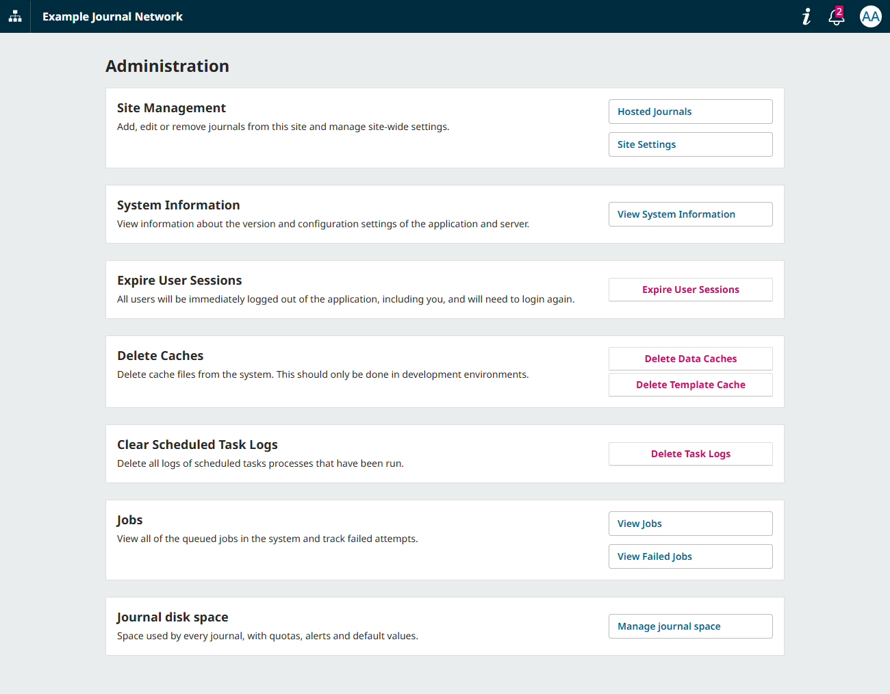

### 2. Overview of all journals

The **Journal disk space** page (`/index/quota`) opens with an overview. Use the **Journal** dropdown to switch between the overview, an individual journal and the site-wide default values.

The overview includes:

- **Total space:** aggregate usage across journals, including file and estimated database usage.
- **Journal status:** the number and names of journals that are closed, approaching a limit, within a limit or unlimited.
- **Space by journal:** the distribution of storage across journals.
- **Where the space goes:** the distribution by file category and estimated database usage.

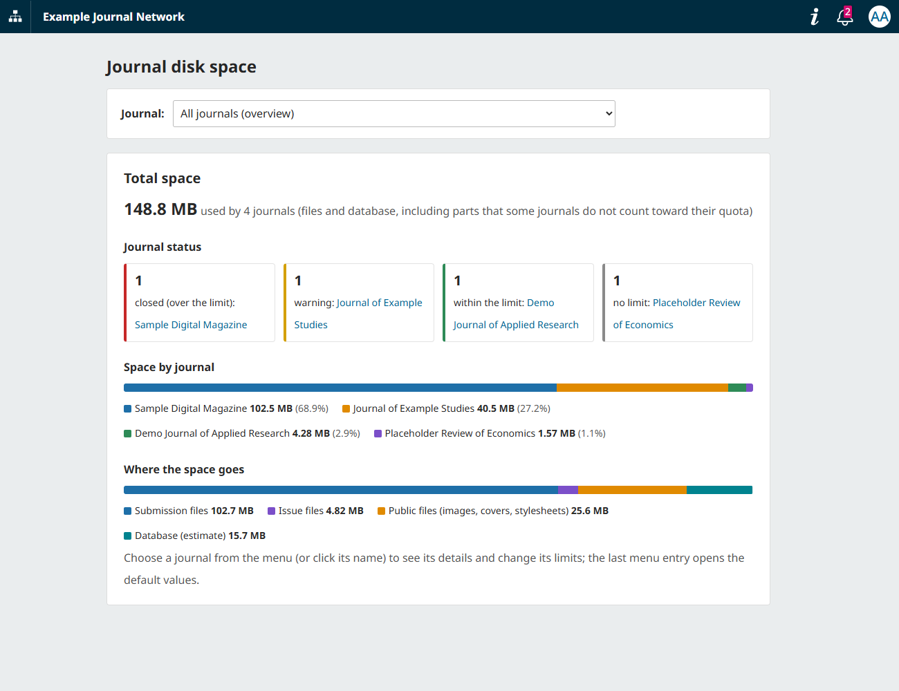

### 3. An individual journal's usage and limits

Select a journal to inspect its usage breakdown, estimated largest database tables, last full measurement and a link to the manager-facing **Disk Space** page.

In **Limits**, select either **Use the default values** or **Custom values for this journal**. Custom values let the administrator set:

- Quota in MB (`0` means unlimited).
- Enforcement: warn and close only after the percentage tolerance, or close immediately at the quota.
- Warning threshold as a percentage of the quota.
- Tolerance as a percentage **of storage**, not an additional time period.

Expand **Emails and what is counted** to configure notification events and repeat interval, and whether public files and estimated database space count toward the quota.

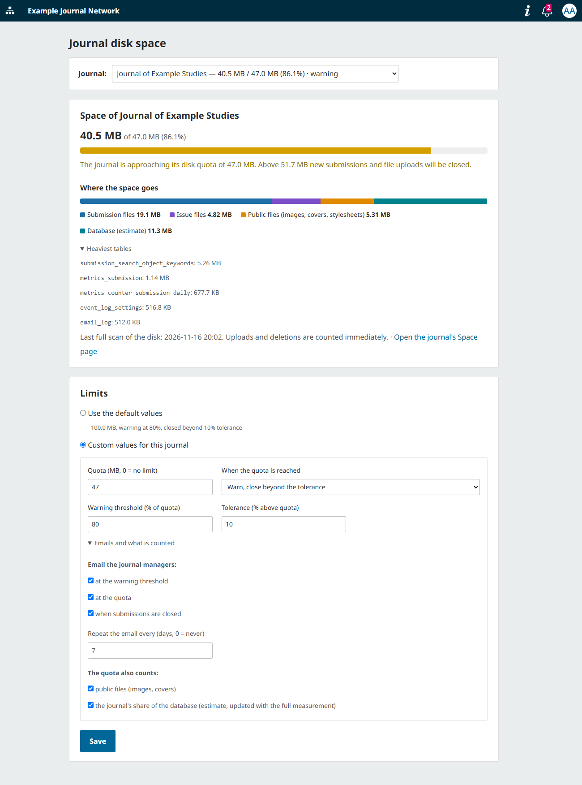

### 4. Site-wide default values

The final dropdown entry, **Default values for all journals**, applies to journals without a custom quota, including newly created journals. The page identifies which journals currently inherit these settings.

The defaults also include **Disk measurement**, the interval for a full scan (24 hours by default). Supported uploads and deletions are accounted for immediately; the full scan reconciles differences.

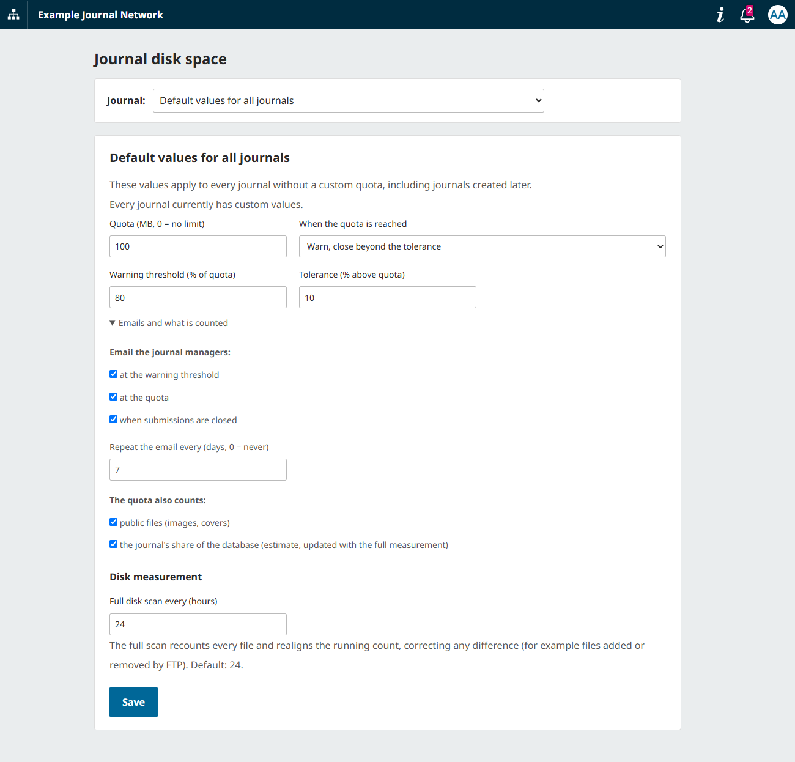

## Journal manager

Journal managers can monitor their journal's storage and receive warnings, but **cannot change its quota**.

### 5. Statistics → Disk Space: warning state

The **Statistics → Disk Space** entry opens `/<journal-path>/quota`. It is available to the journal's managers and site administrators.

The usage bar turns yellow after the warning threshold and red when the quota is exceeded. Below it, the page shows:

- Warning threshold, quota and the limit at which new submissions are closed.
- The date of the last full scan.
- **Measure again**, which requests a new measurement and is limited to once per minute.
- **Where the space goes**, broken down into submission files, issue files, publisher library, other private files, optionally public files, and estimated database space.
- **Largest submissions**, with links to the ten submissions using the most space.
- Guidance on freeing space.

The screenshot below was captured while signed in as a **site administrator**. Its **Manage journal space** link at the bottom is not shown to journal managers.

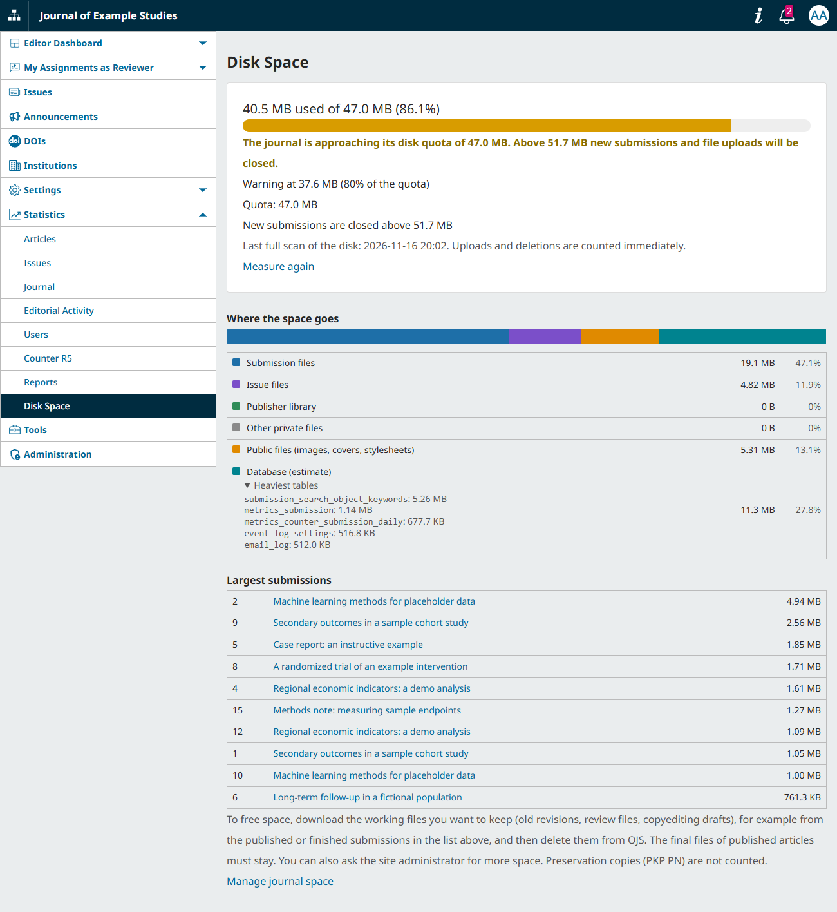

### 6. Statistics → Disk Space: closed state

When the effective limit is exceeded, the page explains that **new submissions and file uploads are closed**. Existing files can still be read, downloaded and deleted.

To reopen the journal, download any working files that must be retained and delete the unneeded files through OJS, or ask the site administrator for more space. Quota-based restrictions are removed automatically once usage is below the applicable limit.

This example is shown from the journal manager's account.

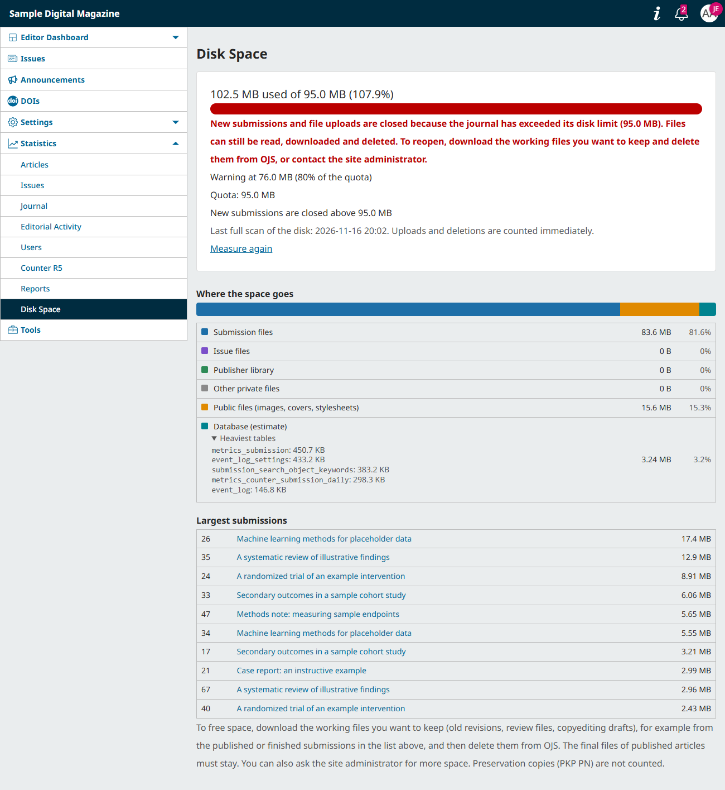

### 7. Tasks notification

Managers receive a **Tasks** notification showing the journal's usage, percentage and current quota status. The plugin maintains one quota notification per journal and updates or removes it as the state changes.

The second notification in this screenshot is a standard OJS reminder, not a Journal Quota notification.

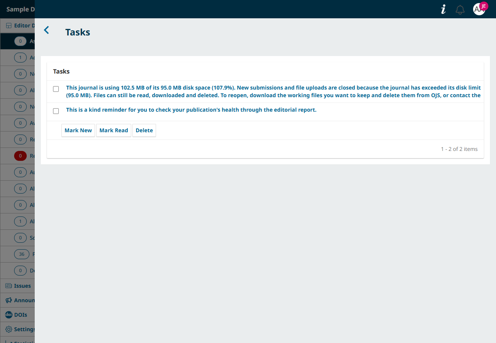

### 8. Email alerts

If configured, **Disk Quota Alert** emails notify the affected journal's managers when usage reaches the warning threshold, exceeds the quota or causes closure. Reminders can be repeated after a specified number of days (seven by default). Failed sends can be retried at the next scheduled check.

This screenshot **reconstructs the default email text with example data**. The local installation used log-mode email delivery; it does not demonstrate successful delivery to a real mailbox.

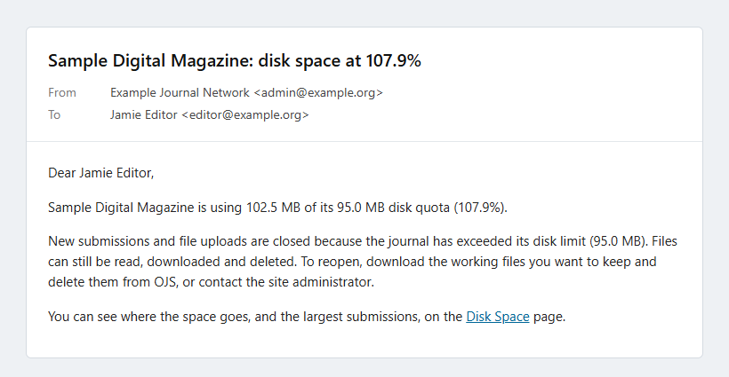

### 9. Email template

Each journal can edit its **Disk Quota Alert** email under **Settings → Workflow → Emails**. Search for the template on the **Manage Emails** page.

Available template data include used space, quota, usage percentage, quota status message and a link to the journal's Disk Space page.

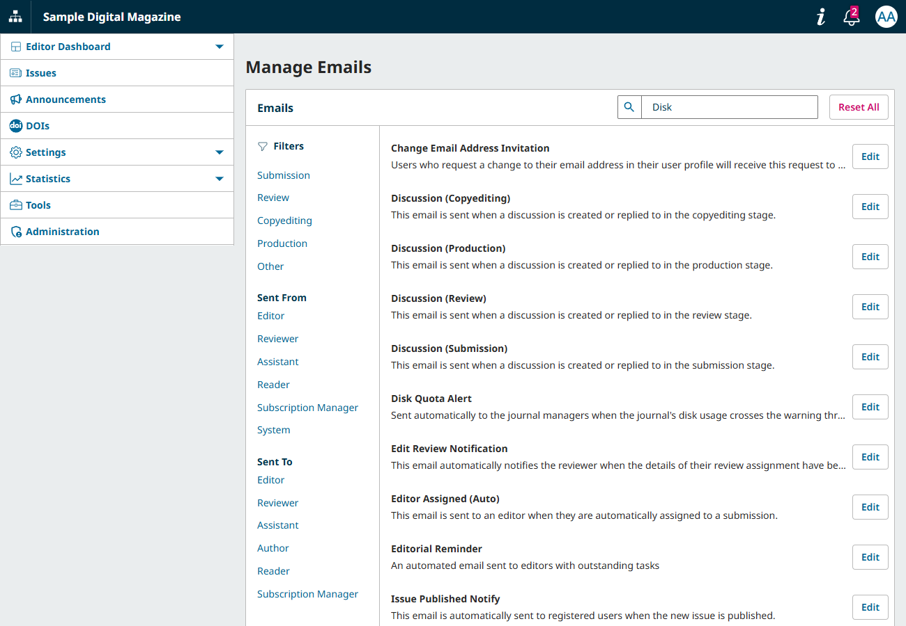

## Authors, editors and readers

### 10. Starting a new submission while a journal is closed

When quota enforcement closes a journal, **Make a Submission** displays OJS's standard message that the journal is not accepting submissions. The plugin does not permanently change the journal's editorial settings; the quota-based closure ends when enough storage is available again.

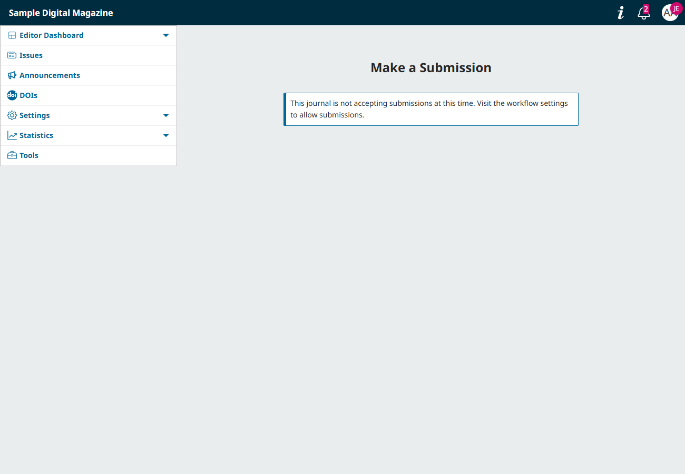

### 11. Public submissions page

Visitors to the journal's public **Submissions** page also see that submissions are currently unavailable.

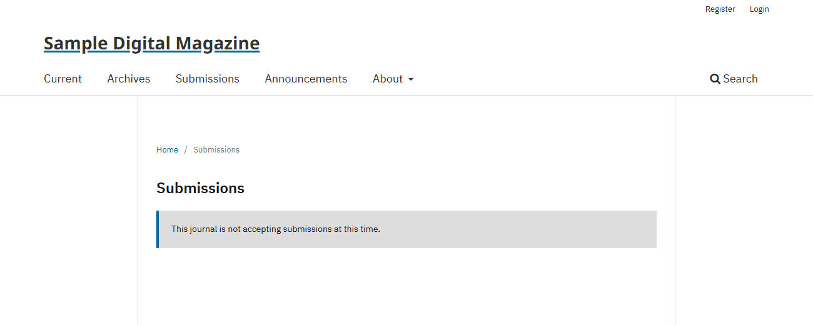

### Uploads that would exceed the limit

The upload form displays a quota explanation if a file would cause the journal to exceed its effective limit. A small file may succeed when space remains, while a larger file is refused. The message tells users how to free space or contact the site administrator.

These restrictions also apply to supported file uploads outside the ordinary submission form, including API and XML-import paths. Site administrators are exempt. Reading, downloading and deleting existing files remain available. There is no separate screenshot for this message in the local test set.

## Quota states at a glance

| State | When it applies | Effect |
|---|---|---|
| Within limit | Below the warning threshold | No warning; an earlier quota notification is removed. |
| Warning | Above the warning threshold (80% by default) | Yellow bar, in-app notification and optional email. |
| Quota exceeded | Above the quota but still within its tolerance, in warning/tolerance mode | Stronger warning, in-app notification and optional email. |
| Closed | At the effective blocking limit | New submissions and supported uploads are blocked; existing files remain accessible. |
| Unlimited | Quota set to `0` | Usage is measured, but no quota warning or block applies. |

The effective blocking limit is the configured quota in immediate-close mode, or the quota plus the configured percentage tolerance in warning/tolerance mode. See the [README](../README.md#how-quota-enforcement-works) for an example.
